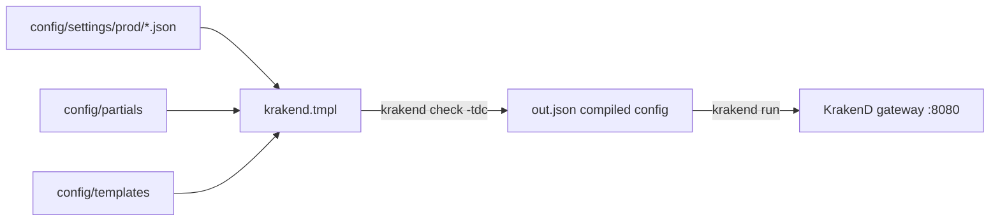

# KrakenD Flexible Configuration

<div align="center">

| <a href="https://youtu.be/U1LHoKWy0HU"></a><br>[Video in English](https://youtu.be/U1LHoKWy0HU) | <a href="https://youtu.be/qeTeLPLnkIY"></a><br>[Video in Spanish](https://youtu.be/qeTeLPLnkIY) |
|---|---|

</div>

Test environment to check the [KrakenD Flexible Configuration](https://www.krakend.io/docs/configuration/flexible-config/) feature, with a GitHub Actions workflow that compiles the config and optionally deploys it to Kubernetes.

> **Attribution:** the structure and the video links in this README follow KrakenD's public flexible-configuration example material. TODO: confirm the exact upstream repository and its license before reuse.

## Prerequisites

- Docker (the examples below use the `devopsfaith/krakend` image), or a local `krakend` binary
- Docker Compose for the compose example
- (CI deploy only) a Kubernetes cluster and a `KUBE_CONFIG` secret, see [CI/CD](#cicd)

## Architecture



This repo contains a basic implementation for flexible configuration, including the use of variables, templates, code snippets and some basic logic to iterate over multiple endpoints.

### Contents:

- `krakend.tmpl`: the base file, including calls to the variables, iteration over available endpoints and some code snippets.
- `Dockerfile`: A docker definition to build an immutable container with KrakenD
- `docker-compose.yml` an example docker compose definition file to be able to execute KrakenD enabling Flexible Configuration.
- `config/partials/*`: some code snippets referenced from base file
- `config/templates/*`: endpoint templates (`endpoint_one.tmpl`, `endpoint_two.tmpl`, `endpoints.tmpl`). Note: the current `krakend.tmpl` builds its endpoints from `endpoints.json` and does not include these templates; see the Bonus Track below.
- `config/settings/{dev|prod}/endpoints.json`: a collection of endpoints (only `prod` exists in this repo)
- `config/settings/{dev|prod}/service.json`: basic configuration parameters for the service
- `.github/workflows/docker.yml`: CI workflow, see [CI/CD](#cicd)

## Running this test

### Using Docker

```shell
$ docker run \
--rm -it -p "8080:8080" \
-v "$PWD:/etc/krakend" \
-e FC_ENABLE=1 \
-e FC_SETTINGS=config/settings/prod \
-e FC_PARTIALS=config/partials \
-e FC_TEMPLATES=config/templates \
-e FC_OUT=./tmp/out.json \
-e SERVICE_NAME="KrakenD API Gateway" \
devopsfaith/krakend check -tdc "krakend.tmpl"
```

### Using Docker Compose

The gateway is published on host port `8081` (container port 8080).

Based on the definition included in the [docker-compose.yml](docker-compose.yml) definition.

```shell
$ docker-compose up
```

### Using the binary locally

```shell
$ FC_ENABLE=1 \
FC_SETTINGS=config/settings/prod \
FC_PARTIALS=config/partials \
FC_TEMPLATES=config/templates \
FC_OUT=out.json \
SERVICE_NAME="KrakenD API Gateway" \
krakend check -tdc "krakend.tmpl"
```

Note: both above alternatives will output a `out.json` file with the compiled version of the config file, useful for debugging purposes.

### Building an immutable Docker artifact

If you use containers, the recommended approach is to write your own Dockerfile and deploy an immutable artifact (embedding the config).

```shell
$ docker build --build-arg ENV=prod -t mykrakend . 
```

This will generate a ready-to-use container named `mykrakend` with the configuration already compiled, checked and validated using the linter (based on the  [Dockerfile](Dockerfile) included in this repo).

To run this new container, you just need to execute:

```shell
$ docker run -p 8080:8080 mykrakend run -dc krakend.json
```

## Configuration

| Variable | Used by | Description |
|----------|---------|-------------|
| `FC_ENABLE` | KrakenD | Set to `1` to enable flexible configuration |
| `FC_SETTINGS` | KrakenD | Settings directory, e.g. `config/settings/prod` |
| `FC_PARTIALS` | KrakenD | Partials directory, `config/partials` |
| `FC_TEMPLATES` | KrakenD | Templates directory, `config/templates` |
| `FC_OUT` | KrakenD | Path of the compiled config file |
| `SERVICE_NAME` | `krakend.tmpl` | Gateway name used in the compiled config |
| `ENV` | Dockerfile build arg | Settings folder to compile (default `prod`) |

Backend hosts live in `config/settings/prod/service.json` and `endpoints.json`. Do not put credentials (such as broker URLs with passwords) in these files; keep them out of version control.

## CI/CD

`.github/workflows/docker.yml` runs `krakend check` on pushes and pull requests, fails if `tmp/out.json` is empty and uploads it as an artifact. On pushes to `main` it deploys, only if the `KUBE_CONFIG` secret (base64 kubeconfig) is set: it recreates the `krakend-config` ConfigMap in the `krakend` namespace and restarts the `krakend` Deployment.

## Troubleshooting

- The workflow fails with "tmp/out.json is empty": the template or settings did not compile; run the local `krakend check` command above to see the error.

## Author

Umesh Khatiwada - https://github.com/umesh-khatiwada

---

| 💡 Bonus Track - Invoking a Dynamic List of Endpoints from the Main Configuration                                                                                                                                                                                                                                                                                                                                                                                                                                                                                                                                                                                                                                                                                                                                                                       |
|---------------------------------------------------------------------------------------------------------------------------------------------------------------------------------------------------------------------------------------------------------------------------------------------------------------------------------------------------------------------------------------------------------------------------------------------------------------------------------------------------------------------------------------------------------------------------------------------------------------------------------------------------------------------------------------------------------------------------------------------------------------------------------------------------------------------------------------------------------|
| Go template functions do not allow the use of dynamic values as paths to templates, which means you cannot iterate a dynamic list of template paths and invoke them from your `krakend.tmpl`.<br/><br/>However, you can easily overcome this limitation by generating a nesting template with a simple bash command, such as:<br/><code>tree -J -I "endpoints.tmpl" &#124; jq -r ' ( .[0].contents[].name &#124; "{{ template \\"\\(.)\\" . }}," )' &#124; sed '$s/,$//' > endpoints.tmpl</code><br/><br/>Executing this command from the config/templates folder will generate a new endpoints.tmpl, which will invoke all available templates, comma-separated. You can then simply invoke that endpoints.tmpl from your main configuration. You will only need to execute that command again whenever you add new endpoints to the templates folder. |
